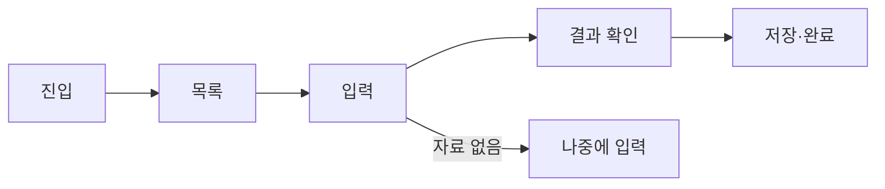

# [기능명] 1-pager

- 상태: `초안` / `확인 요청(MM/DD)` / `✅ 확인됨(○○님, MM/DD)`
- 작성: 김수연 · 요청자: ○○님 · 최종 승인: ○○님
- 크기: S / M / L

> 착수 관문: 상태가 `✅ 확인됨`이 되기 전에는 화면 코드를 쓰지 않는다.
> 변경 관문: 확인된 뒤 흐름·화면·범위가 달라지면 `변경 로그`에 적고 다시 확인받는다.

---

## 1. 목적
- 해결할 문제:
- 잘 되면 달라지는 것:

## 2. 사용자
| 사용자 | 권한 | 쓰는 빈도 |
|---|---|---|
| | | |

## 3. 지금 방식
- 지금은 어떻게 하나: (엑셀/수기/기존 시스템)
- 가장 번거로운 단계:
- 받은 자료: (파일명)

## 4. 핵심 흐름 — 실제 예시로 채운다

예시 건: [요청자가 준 실제 건 1개, 예: "11월 망고 수입 1건"]

| 순서 | 사용자 손에 있는 자료 | 화면에서 입력·선택 | 화면에 나오는 결과 |
|---|---|---|---|
| 1 | 예: 인보이스 | 제품, 수량 1,000개 | 제품대금 $1,200 |
| 2 | | | |
| 3 | | | |
| 끝 | | 저장 | 예: 개당 원가 960원, 이력에 저장 |

## 5. 화면 목록
| 화면 | 보여 줄 데이터 | 할 수 있는 동작 | 권한 없음 | 빈 데이터 | 에러 | 로딩 |
|---|---|---|---|---|---|---|
| | | | | | | |

와이어프레임: `wireframe.png` (손그림·박스 수준이면 충분)

## 6. 범위 밖 (이번에 안 하는 것)
-
-

## 7. 열린 질문
| 질문 | 누구에게 | 답 | 확인일 |
|---|---|---|---|
| **이 순서(4번 흐름)대로 입력하시는 게 맞나요?** ← 항상 둔다 | 요청자 | | |
| | | | |

## 8. 완료 기준 (Definition of Done)
- [ ] 4번 흐름을 예시 건으로 처음부터 끝까지 실행할 수 있다
- [ ] 계산·변환이 있으면 **요청자의 실제 자료 숫자와 결과가 맞는다** (main 머지 전에 확인)
- [ ] 5번의 예외(권한 없음·빈 데이터·에러·로딩)가 화면에 처리돼 있다
- [ ] 6번 범위 밖 항목은 만들지 않았다
- [ ] 중간 시연을 1회 했다 (L 크기)
- [ ] 요청자 최종 확인: ○○님, MM/DD
- [ ] (기능별 기준) 예: "목록 필터 3종 동작"

## 9. 결정·변경 로그
`정한 사람`과 `요청자 확인`은 다른 칸이다. 내가 정한 것은 요청자 확인이 빈 채로 남는다.

| 날짜 | 결정·변경 | 1-pager와 달라지나 | 정한 사람 | 요청자 확인 |
|---|---|---|---|---|
| 11/23 | 상세는 모달 말고 별도 페이지 | 예 (5번 화면) | 김수연 | ○○님 11/24 |
| | | | | |
